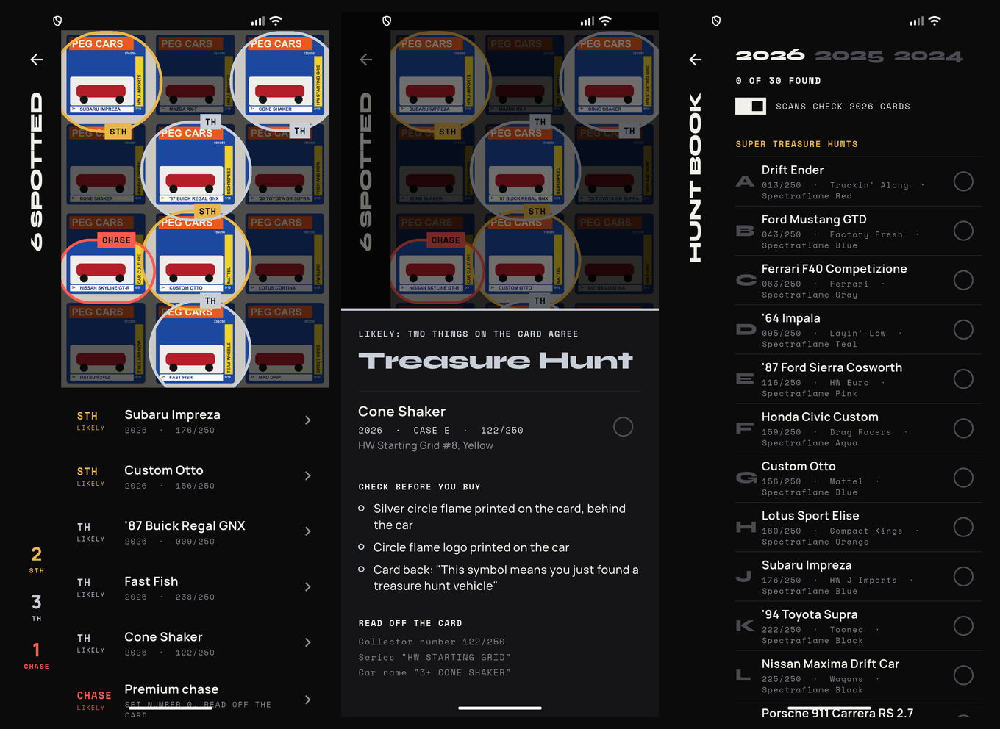

<p align="center"></p>

<h1 align="center">Peghunt</h1>

<p align="center"><b>One ring on a wall of pegs.</b><br>
Point your phone at a wall of Hot Wheels cards. Peghunt rings the Treasure Hunts, Super Treasure Hunts and Chase cars in it.</p>

<p align="center"></p>

---

## Why

A store wall holds a hundred cars, and the ones worth hunting look almost
the same as the rest. A Super Treasure Hunt shares its card and its number
with the regular car next to it. What gives it away is a small gold flame
printed behind the car, Spectraflame paint and rubber tires. That's hard to
remember and harder to spot when you're standing in an aisle.

Brickit does this for a pile of LEGO: take one photo and it shows you where
each piece is. Peghunt does the same for a wall of diecast.

## What it does

- **Hunt.** A full-screen camera. Take one photo of the wall.
- **Rings.** The photo dims, and a ring draws itself around every card worth
  a look: **gold** for a Super Treasure Hunt, **silver** for a Treasure Hunt,
  **red** for a Chase. Solid rings are likely hits. Dashed rings are possible
  hits, where only one thing on the card matched.
- **Find it.** Every hit is also listed under the photo. Tap a row and the
  photo flies to that card. Tap it again to see what to check before you buy
  (gold flame, Spectraflame paint, Real Riders tires, TH logo).
- **Hunt book.** The 2024, 2025 and 2026 Treasure Hunts, Super Treasure
  Hunts and chase cars. Tick off the ones you've found, and choose which
  years a scan checks against.
- **What it read.** One tap outlines every line of text the scan read, so a
  missed car shows whether its name was never read (glare, too far) or read
  but not matched. A photo taken in the app can be saved to the gallery at
  full size.
- **Works offline.** Everything runs on the phone: no account, no network,
  no photos uploaded anywhere.

## How it works

```
photo ──► ML Kit text recognition (on device)
            │  small photo? also read as 4 enlarged tiles
            │  lines of text + where they sit in the photo
            ▼
          matcher (lib/scan/matcher.dart)
            │  "SUBARU IMPREZA"     name strip, bottom of the card ──┐
            │  "HW J-IMPORTS"       series tab, up the side ────────┤ grouped per card
            │  "176/250"            collector number, top ──────────┘
            │  "0/5"                chase slot
            │  "...treasure-hunt vehicle!"  card back
            ▼
          every car of 2024, 2025 and 2026 (840 cars, 90 of them hunts)
            │  the name, number and series must agree on ONE car,
            │  and no ordinary car may fit just as well
            ▼
          rings, with how sure each one is
```

**What real cards taught it.** The first real photos (a collection on a mat
and shop walls in India) changed the design:

- **The name is the clue that survives.** Shops stack cards so only the
  name strip at the bottom shows; the collector number at the top is small
  and usually hidden. Names lead, numbers back them up.
- **Old hunts come back as ordinary cars.** Bone Shaker was a 2024 Treasure
  Hunt and is an ordinary 2026 car; Cone Shaker is the 2026 E case TH and an
  ordinary 2025 HW Metro car. So every read is matched against all 840 cars,
  not just the 90 hunts. A name alone counts only if no ordinary car shares
  it; the series tab or the number settles the rest (Cone Shaker on an
  HW Starting Grid card is the TH, on HW Metro it is not).
- **OCR is rough.** Real reads included `CONE SHAXER`, `ROD SOUAD`,
  `RODGER D00GER`, and `FORD MOOL A CUSTOV / PERSONNALISÉ '31` (bilingual
  cards put the French mid-name). Names are compared as letter skeletons
  with look-alike digits folded in and a strict error budget, and the
  closest car wins, so `SPEED DRIVER` stays an ordinary 2025 car and is not
  taken for the Sweet Driver TH.
- **Small photos hide small text.** ML Kit misses text under about 8 px. A
  photo sent over WhatsApp (about 1300 px) reads 2.5 times more words as
  four enlarged tiles, so small photos get that; a 12 MP camera photo is
  read once, as is (measured: ML Kit reads 8 px text in a full 4000 px frame).
- **Premium cards reuse castings.** A Summit Surge McLaren Speedtail is not
  the 2025 STH. A name-only match next to premium-line words (Real Riders,
  Car Culture, Boulevard, Silver Series) is dropped.

On those 19 photos it rings three real 2026 Treasure Hunts (Cone Shaker in
two photos, Ford Model A Custom '31) and one premium card as a possible.

| Certainty | When | Ring |
|---|---|---|
| **Confirmed** | The card says so: the Treasure Hunt line printed on the back | solid |
| **Likely** | Two clues agree on one hunt car: name and series, name and number, or number and series | solid |
| **Possible** | One clue matched, and no ordinary car shares it | dashed |

A card's number (top) and name strip (bottom) are found separately and then
joined when they agree on a car, so each card gets one ring round the whole
card. Two name strips are never joined: stacked copies of one Treasure Hunt
each get a ring.

## Chase cars

A chase is a premium card, and every line marks it differently, so each one
is matched by its own rule:

| Line | The chase | What decides it |
|---|---|---|
| Car Culture (2024–2026) | a second copy of one of the set's own cars | the set number: **0/5** is the chase, 2/5 the regular copy. 2026 chases are gold |
| Vintage Racing Club, Celebrations, Anniversary sets, The Hot Ones | the set's last car | the set number: **6/6**, **5/5**, **8/8** |
| Fast & Furious Premium 2026 | a Spectraflame twin of a regular car | nothing printed: same card, same number. Only ever "worth a look" |

So a chase name with its chase number is **likely**; with the set or line name
but no number read, or a name no mainline car shares (the 2025 Hot Ones BMW
M1 Procar), it is **possible**; with another set number, it is the regular
car and gets no ring. A `0/5` read with no name is still a likely chase.

## The lists

- `assets/hunts.json`: 15 Treasure Hunts and 15 Super Treasure Hunts for
  each of 2024, 2025 and 2026, with case letter, collector number, series
  and colour, plus 35 chase cars with their line, set and set number.
  Compiled from collector checklists (Muncle Mike's, Orange Track Diecast,
  Hot Wheels Hub, 164 Custom, HW Headline).
- `assets/castings.json`: every mainline car of those years (750), from
  Muncle Mike's complete casting lists. Every hunt was cross-checked
  against it by number, name and series, and all 90 agree.

Adding a year means one block in each file. The tests check every year has
15 of each kind with unique numbers and case letters.

## Build

Flutter 3.38 (Dart 3.10), Android only.

```bash
flutter pub get
flutter test                                    # 44 tests: matcher, real cards, chases, tiles, screens
flutter build apk --release --split-per-abi     # build/app/outputs/flutter-apk/
```

Release builds are signed with `android/key.properties` if it exists. If it
doesn't, they fall back to the debug key, so a fresh clone still builds.
**Testing on real photos.** `tool/ocr_dump.dart` is a second entry point
that runs the real ML Kit reader on an emulator or phone over a folder of
photos served from the computer by `tool/ocr_server.py`, and writes back
every line read and every hit. That is how the matcher was tuned on real
cards.

```bash
python tool/ocr_server.py training/photos out.json
flutter run -t tool/ocr_dump.dart -d emulator-5554 --release --no-resident
```

It installs over the app (same package), so reinstall the app afterwards.

**Testing without a store.** `tool/make_test_wall.py` draws a 12 MP fake
peg wall laid out like 2026 cards, with five hunts, a chase, and decoys such
as an ordinary Bone Shaker, plus a copy saved sideways with an EXIF rotation
tag the way a phone saves portrait photos. The screenshots above are that
wall. `tool/make_icons.py` redraws every launcher icon from the same
geometry as the in-app mark.

## Project layout

```
lib/
  data/hunt_book.dart       the lists, as Dart
  data/app_state.dart       found cars and scan years, saved on the phone
  scan/text_match.dart      OCR-tolerant reading: skeletons, fuzzy find, numbers, 0/5
  scan/matcher.dart         lines of text → hits
  scan/tiled_ocr.dart       small photos read whole and as enlarged tiles
  scan/scanner.dart         ML Kit on the phone, a fake in tests
  ui/                       hunt (camera), result (rings + list), hit sheet, book
assets/hunts.json           2024–2026 Treasure Hunts and Super Treasure Hunts
assets/castings.json        every 2024–2026 mainline car
training/                   where real photos go (git-ignored)
tool/                       OCR dump, photo server, test wall, icons
```

## Next

1. **Full-size photos and labels.** The first photos were WhatsApp copies.
   Originals from the phone camera, and knowing which cards in them are
   hunts, will tell how well it does where it matters.
2. **See the flame.** The text can't tell a Super Treasure Hunt from its
   regular twin (same card, same number). A small on-device detector for the
   gold or silver circle flame behind the car can.
3. **Loose cars.** Spectraflame paint and Real Riders tires, for tables of
   cars out of the card.

## Disclaimer

Peghunt is a fan project. It is not made by, endorsed by or affiliated with
Mattel. Hot Wheels, Treasure Hunt and Super Treasure Hunt are trademarks of
Mattel, Inc. The lists are community-sourced, so check the car itself
before you pay.

## License

MIT. See [LICENSE](LICENSE).
